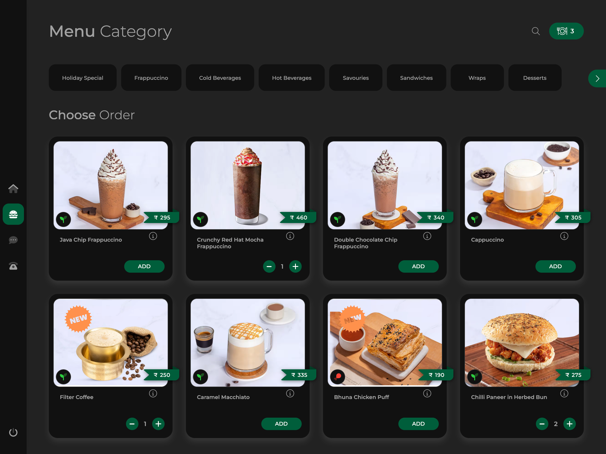
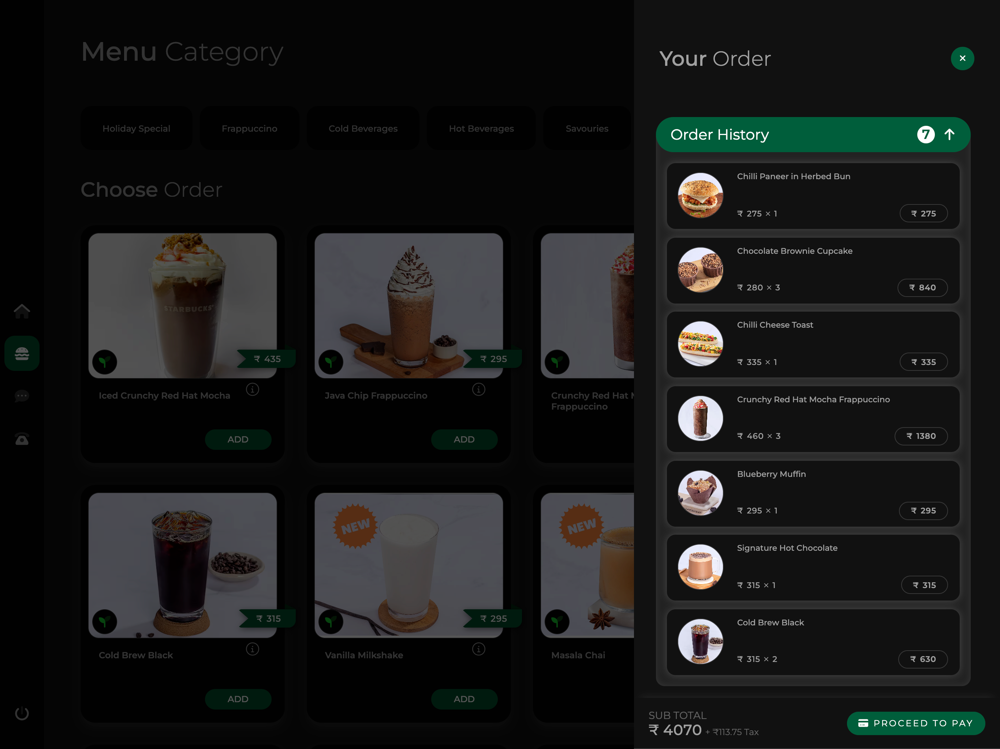
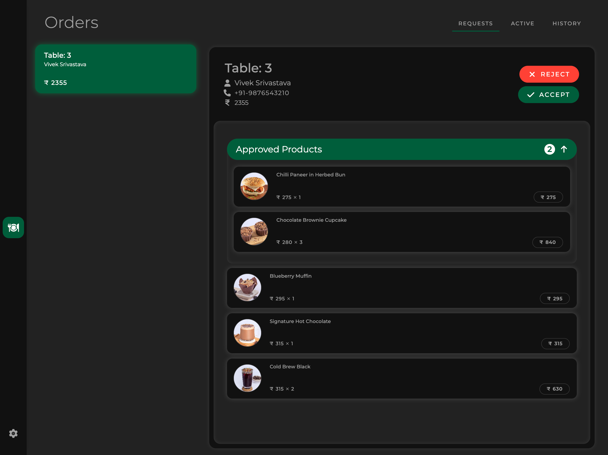
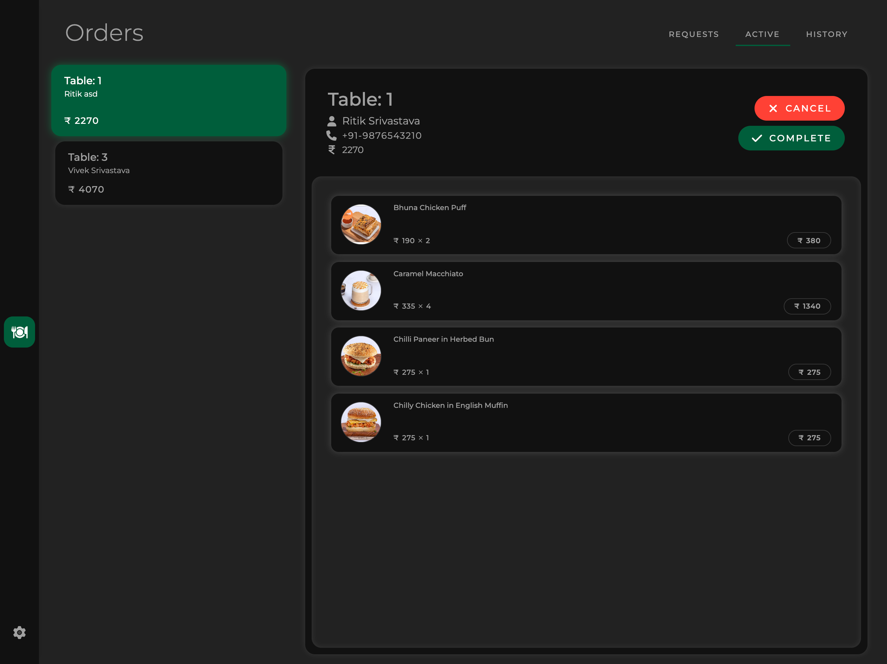

# YOUR_PROJECT_NAME

YOUR_PROJECT_NAME is a full-stack, AI-powered contactless dining platform designed to digitize restaurant operations. From scanning a QR code to placing an order, chatting with an intelligent AI assistant, and managing kitchen workflows, everything runs on a clean, modern web app built with **Next.js**, **MongoDB**, and **SCSS**.

---

## Overview

YOUR_PROJECT_NAME has two interfaces: one for **customers** and one for a **restaurant's admin**.

---

## Features

- **QR Code-Based Access**: Every table gets a unique QR code for instant menu access.
- **AI-Powered Assistant**: Chat with Jarvis, your intelligent restaurant assistant for personalized menu recommendations.
- **Smart Ordering**: Customers can browse menus, add items, and place orders without downloading an app.
- **Live Kitchen Dashboard**: Real-time order updates for chefs to prep efficiently.
- **Admin Panel**: Manage tables, orders, inventory, payroll, and more.
- **Real-Time UI**: Fast, responsive, and optimized for mobile, tablet, and desktop.
- **Dark Theme Support**: Modern design with animation and smooth transitions.

---

## AI Integration (Jarvis)

Built on **Google Gemini (Gemma-27b)** via the **Vercel AI SDK**, Jarvis uses prompt engineering to act as a virtual waiter.

- **Context-Aware**: Dynamically injects real-time menu data from MongoDB into system prompts for accurate allergen and ingredient answers.
- **Structured Output**: Uses custom tokens to return direct item recommendations adjacent to natural language responses.
- **No Vectors Required**: Efficient, real-time context injection without complex vector databases.

---

## Tech Stack

- **Frontend**: React + Next.js
- **Styling**: SCSS (SASS)
- **Backend**: API Routes in Next.js
- **Database**: MongoDB
- **Authentication**: NextAuth.js
- **State Management**: React Context + Redux
- **AI & Chatbot**: Vercel AI SDK + Google Gemini (Gemma-27b)

---

## Getting Started

### Prerequisites

- Node.js version specified in `.nvmrc`
- pnpm
- A MongoDB instance

### Installation

```bash
pnpm install
```

### Environment Configuration

Create a local environment file and set the variables required by your deployment, including your MongoDB connection string, authentication secret, and AI provider credentials.

TODO: document the exact environment variables used by this project.

### Development

```bash
pnpm play
```

The app runs at `http://localhost:3000`.

To run with Doppler-managed secrets:

```bash
pnpm dev
```

### Production Build

```bash
pnpm build
pnpm start
```

---

## Usage

### Customer Flow

1. Open `http://localhost:3000/scan` or navigate directly to a restaurant menu such as `http://localhost:3000/<restaurant>?table=1`.
2. Add items to the cart and place an order.
3. Enter a name and phone number when prompted.

### Admin Flow

1. Open `http://localhost:3000` and scroll to the login section.
2. Sign in with the admin credentials configured in your database.
3. Open the Admin Dashboard at `http://localhost:3000/dashboard` or the Kitchen Dashboard at `http://localhost:3000/kitchen`.

---

## Screenshots

### Menu Interface

<p align="center">
  
  
</p>

### Admin Dashboard

<p align="center">
  
  
</p>

---

## Tags

`nextjs` `react` `javascript` `mongo` `sass` `typescript` `ai` `chatbot` `ai-assistant` `admin-panel` `dashboard` `qr-code` `realtime` `restaurant` `ecommerce` `responsive` `dark-theme` `ui` `animation` `scanner`
